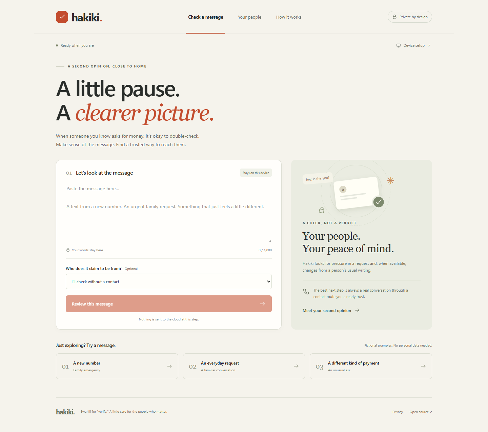
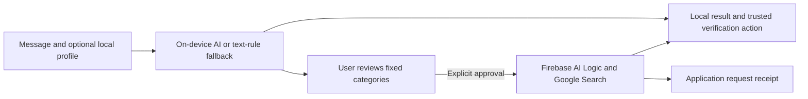

# Hakiki

A private second opinion on family money requests. Pause, inspect the request, and contact the person through a route you already trust. Hakiki does not authenticate a sender or certify a request as safe.

**Working hybrid implementation candidate.** Real on-device comparison and profile generation pass through Firebase AI Logic, and cloud inference succeeds through its Agent Platform (formerly Vertex AI) backend on Soma's approved existing billing. The hosted app displays complete cloud output and search sources. Tested raw-message canaries remain excluded from outbound requests. Model usefulness, human outcomes, and exact Nano 4 competition eligibility are separate evidence gates; see [release status](docs/STATUS.md).

[Try the hosted candidate](https://hakiki-hybrid-2026.web.app).



## Run locally

Use Node.js 24 or newer and desktop Chrome for browser tests.

```sh
npm ci
npm run dev
```

Open the URL printed by Vite. Without Firebase configuration, text rules and fictional examples work; AI buttons explain their prerequisites. No sign-in or private chat is required.

For AI, copy `.env.example` to `.env.local` and supply your Firebase web app configuration, reCAPTCHA Enterprise site key, and cloud model. Enable Firebase AI Logic with your selected provider (`google-ai` or `agent-platform`), usable quota/billing, and App Check. Register the hosting domain in reCAPTCHA Enterprise. For localhost, register an App Check debug token and put it **only** in `.env.development.local`. Never commit that file or include debug tokens in a production build.

The owner setup helper `node scripts/provision.cjs PROJECT_ID PROJECT_NUMBER WEB_APP_ID [google-ai|agent-platform]` uses an authenticated global Windows Firebase CLI. It registers Hakiki-specific attestation and writes ignored environment files; it does not attach billing or change existing service enforcement. Current configuration uses `hakiki-hybrid-2026` for Hosting and a separate Hakiki web app in owner-selected `soma-meta-jerem-2026` for AI with `VITE_AI_PROVIDER=agent-platform`. The owner approved usage on Soma's existing Cloud billing. Existing Soma app attestation was not changed.

## Local AI

Open **Device setup**. A compatible desktop Chrome installation, supported hardware, and downloaded built-in model are required. Enable the multimodal Prompt API flag if required by your Chrome version, restart, and choose **Enable on-device AI**. Hakiki requests English text input/output and uses Firebase `ONLY_ON_DEVICE` mode for messages and profiles. An unavailable model never triggers a raw-text cloud fallback.

See [Firebase hybrid setup](https://firebase.google.com/docs/ai-logic/hybrid/web/get-started) and [Chrome requirements](https://developer.chrome.com/docs/ai/get-started). Initial automation disabled Chrome model services. Restoring component updates/OptimizationHints and allowing the download made the isolated Chrome 157 profile usable. `LIVE_LOCAL=1` runs the real comparison/import test with an isolated persistent profile; its first download can take several minutes. Chrome's broker identified `nano_v3_gpu_component`, version `2025.8.8.1141`; this establishes neither Nano 4 identity nor eligibility. See [model eligibility](docs/MODEL_ELIGIBILITY.md).

## Validate

```sh
npm run typecheck
npm test
npm run build
npm run test:e2e
npm run evaluate
```

Unit tests explicitly mock Firebase transport when testing routing and invalid responses. Browser tests exercise the UI, local-only network behavior, offline/reconnection, malformed exports, and mobile layout. The normal suite skips live AI calls. Set `LIVE_AI=1` to require successful real cloud inference, or `LIVE_TRANSPORT=1` to audit the real outbound contract and service-error handling. These are different evidence gates. Set `E2E_BASE_URL` to test a hosted release, including its offline shell.

`npm run evaluate` reproduces 80 authored synthetic English scenarios: 20 development and 60 evaluation. Rules flagged 18/30 imposter scenarios and 12/30 genuine scenarios in evaluation: **60% cue coverage and 40% false flags**, not validated fraud-detection accuracy. Local/cloud/hybrid comparison, profile ablation, and user studies are not measured. See [evaluation evidence](docs/evidence/evaluation.json).

## Architecture and privacy



`src/ai.ts` contains runtime Firebase SDK calls. `src/domain.ts` defines a strict allowlist of categorical cloud inputs. Arbitrary keys and free text are rejected. Raw messages, imports, phone numbers, names, and personal model findings are excluded from cloud generation. The receipt covers application AI request attempts, not infrastructure metadata. An attempt may fail before transmission; completion is confirmed by the SDK response.

Profiles are generated locally, then shown for review and editing before saving. Model summaries can repeat private details; they are not guaranteed sanitized. Saved profiles have no application-level encryption. Raw imports and unconfirmed drafts stay in memory and can be discarded. Clear the current check and delete profiles separately. App Check, Hosting, and Remote Config use normal service metadata. Search suggestions are isolated in a sandboxed frame. The service worker caches app assets, never user content or cloud responses. Offline reopening requires one completed online visit.

Stack: React 19, TypeScript, Vite, Firebase JS SDK 13.3, App Check, AI Logic, Remote Config, and Firebase Hosting. No Analytics, Firestore, named accounts, or backend conversation storage.

## Build and release documents

- [Product requirements](docs/PRD.md), [sprints](docs/BUILD_PLAN.md), and [privacy contract](docs/PRIVACY.md).
- [Evaluation protocol](docs/EVALUATION.md) and [actual release status](docs/STATUS.md).
- [GitHub milestones](https://github.com/Jeremiah-Sakuda/hakiki/milestones).

Deploy `dist` with `firebase deploy --only hosting --project hakiki-hybrid-2026`. Keep AI and hosting project configuration distinct. Do not overwrite another project's Remote Config template; the app reads namespaced `hakiki_playbook_version` with a bundled default.

English desktop text is the baseline. Swahili quality, screenshots, iPhone, human walkthroughs, a public demonstration video, and hackathon submission are not completed. [Apache License 2.0](LICENSE).
